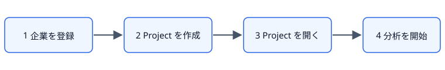
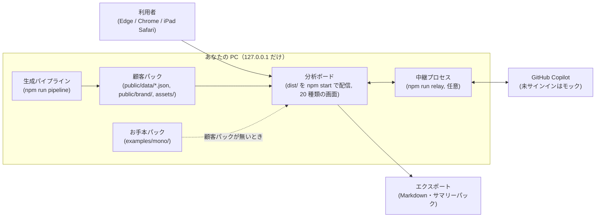
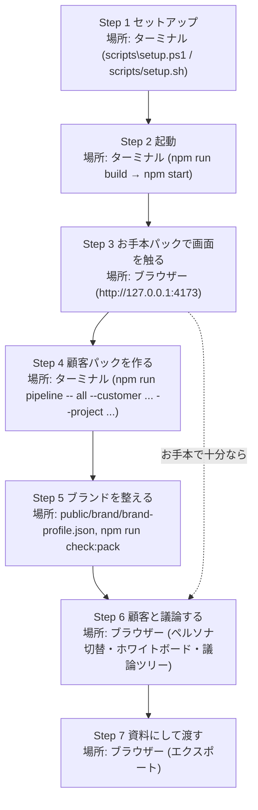

# Business Analytics Studio（ビジネス議論の分析ボード）

顧客との議論を、課題・解決策・優先度・ナレッジグラフ・アーキテクチャ・議論ツリー・ガント・ホワイトボード・3D ビューなどで見せる、顧客固有の情報を持たない共通アプリ（雛形）です。
顧客固有の値は、すべて「顧客パック」（`public/data/*.json` など）にあり、アプリ本体のコードには入っていません。顧客パックがないときは、架空企業の「お手本パック」で起動します。

## はじめての方へ（5 分で全体像をつかむ）

### このアプリで「何ができる」か

| 知りたいこと | 使う画面 |
|---|---|
| 結論 | サマリー |
| 何から手を付けるか | 優先順位分析／2×2 マトリクス／ランキング表 |
| 課題と解決策 | 課題-解決策分析／ナレッジグラフ |
| ToBe（あるべき姿） | アーキテクチャ図 |
| いつ・誰が | ガントチャート |
| 現場のイメージ | 3D ビュー／2D 図面／地図／ミニ・モックアプリ |
| 議論を残す | 議論テーマ／ホワイトボード／議論ツリー |
| 資料にする | エクスポート／Engagement サマリーパック |

画面つきの手順は [users-guide/01-quick-start.md](users-guide/01-quick-start.md) を見てください。アプリの中にも、メイン画面の「はじめての方へ」、初回起動のウェルカム、分析画面の「使い方」ボタン（顧客パックの説明つき）があります。



### 全体の構成（コンポーネント図）



| 部品 | 役割 | 場所 |
|---|---|---|
| 分析ボード | 20 種類の画面で顧客との議論を見せる | `dist/`（`npm start` で配信） |
| 顧客パック | 顧客固有の値（データ・ブランド・素材）をすべて持つ | `public/data/*.json`、`public/brand/`、`assets/` |
| お手本パック | 顧客パックが無いときに使う架空企業のデータ | `examples/mono/` |
| 生成パイプライン | 顧客パックを調査・生成する | `npm run pipeline` |
| 中継プロセス | 分析ボードと GitHub Copilot をつなぐ（任意） | `npm run relay` |
| エクスポート | 議論の結果を資料にする | Markdown・Engagement サマリーパック |

### 作業手順（Step 図）



| Step | 何を・どこでするか | 何ができるようになるか（完了の目安） | 次へ進む条件 |
|---|---|---|---|
| 1 | ターミナルで `powershell -ExecutionPolicy Bypass -File scripts\setup.ps1`（macOS は `bash scripts/setup.sh`）。`-DryRun` / `--dry-run` で内容だけ確認でき、失敗時は `logs/setup.log` を見る | 必要な道具と依存パッケージがそろう | エラーなく終わる |
| 2 | ターミナルで `npm run build` のあと `npm start`（または `start.cmd` / `./start.sh`） | 分析ボードが起動する。「お手本パックで起動しています」と出れば正常 | 起動メッセージが出る |
| 3 | ブラウザーで http://127.0.0.1:4173 を開き、左メニューとツールバーのペルソナで画面を切り替える | 20 種類の画面の見方がわかる | 画面を一通り触れた |
| 4 | ターミナルで `npm run pipeline -- all --customer ... --project ...`（research / build に分けて実行も可） | 顧客パックができる | `npm run check:pack` と `npm run verify:pack` が合格 |
| 5 | `public/brand/brand-profile.json` などを編集（再ビルド不要）。手順は [ブランド色・ロゴ・フォント・BGM の差し替え](#4-ブランド色ロゴフォントbgmの差し替え手順) | 顧客らしい見た目になる | `npm run check:pack` が合格 |
| 6 | ブラウザーでペルソナ切替・ホワイトボード・議論ツリーを使う。進め方は [users-guide/02-meeting-playbook.md](users-guide/02-meeting-playbook.md) | 顧客との議論を画面で進め、残せる | 議論の結果がそろった |
| 7 | ツールバーの「エクスポート」「Engagement サマリーパック」「保存」 | Markdown やサマリーパックとして渡せる | 資料を渡した |

### つまずいたとき

| 症状 | まず確認すること |
|---|---|
| node が見つからない | ターミナルを開き直す |
| 画面が開かない | `npm run build` を実行したか、URL が正しいかを確認する |
| AI が答えない | `npm run relay` を起動し、`copilot` で `/login` する（未サインインはモックで動きます） |
| 顧客パックが反映されない | `dist/data/` の JSON を確認し、`npm run check:pack` を実行する |
| 開発キットで困った | [users-guide/build-kit/01-writing-requests.md](users-guide/build-kit/01-writing-requests.md)、[07-troubleshooting.md](users-guide/build-kit/07-troubleshooting.md) |

## ドキュメント

全体の索引は [users-guide/README.md](users-guide/README.md) です。役割に合わせて読んでください。

| 対象 | 文書 |
|---|---|
| このアプリを使う（事業部長・Product Manager・戦略コンサルタント）。**初めての方はここから** | [01. クイックスタート](users-guide/01-quick-start.md)（画面つき）／ [02. 顧客との議論の進め方](users-guide/02-meeting-playbook.md)／ [03. 用語集と情報の取り扱い](users-guide/03-glossary-and-data-handling.md) |
| カスタマイズ・運用する Software Engineer | [1. アーキテクチャ](users-guide/engineering/01-architecture.md)／ [2. 顧客パック](users-guide/engineering/02-customer-pack.md)／ [3. ブランドとテーマ](users-guide/engineering/03-branding-and-theme.md)／ [4. 画面・機能の追加](users-guide/engineering/04-extending.md)／ [5. AI と中継プロセス](users-guide/engineering/05-ai-relay.md)／ [6. テストと検証](users-guide/engineering/06-testing.md)／ [7. ビルド・配布・運用](users-guide/engineering/07-build-and-distribution.md) |
| 開発キット（conductor）で開発を進める | [1. 依頼の書き方](users-guide/build-kit/01-writing-requests.md)／ [2. 実行中と終了後](users-guide/build-kit/02-during-and-after-run.md)／ [3. 仕組み](users-guide/build-kit/03-how-it-works.md)／ [4. カスタマイズ](users-guide/build-kit/04-customization.md)／ [5. スクリプトリファレンス](users-guide/build-kit/05-scripts-reference.md)／ [6. 品質ゲート](users-guide/build-kit/06-quality-gates.md)／ [7. トラブルシューティング](users-guide/build-kit/07-troubleshooting.md)／ [8. ロードマップと KPI](users-guide/build-kit/08-roadmap.md) |
| 管理データ（要求・カタログ・試験）の閲覧 | [EABK Studio の利用ガイド](EABK-Studio/users-guide/README.md) |
| 配布・要求・手動テスト | [配布](docs/distribution.md)／ [要求定義書](docs/requirements-definition.md)／ [カタログ](docs/catalog.md)／ [手動テスト](docs/manual-tests.md)／ [System Test の契約](tests/system/CONTRACT.md)／ [CREDITS](CREDITS.md) |

要求の正本は `docs/requirements-definition.md`（と `docs/requirements/`）、実装の対応表は `docs/catalog.md` です。

## 対応するブラウザーと端末

- Windows / macOS の最新の Microsoft Edge と Google Chrome。
- iPad の Safari では、インクとタッチの主要機能（ペンの描画、指のパン／ズーム、Markdown 出力）が動きます（[6. iPad 実機での確認手順](#6-ipad-実機での確認手順)）。
- 開発・生成には Node.js LTS（v22 以上）が必要です。

## 1. セットアップスクリプトの使い方

何も入っていない Windows / macOS の PC でも、セットアップスクリプトだけでお手本パックが起動するところまで進められます。

| PC | 実行するもの | 実行のしかた（リポジトリのルートで） |
|---|---|---|
| Windows | PowerShell スクリプト `scripts\setup.ps1` | `powershell -ExecutionPolicy Bypass -File scripts\setup.ps1` |
| macOS | シェルスクリプト `scripts/setup.sh` | `bash scripts/setup.sh` |

スクリプトは、次の順に確認して、**不足しているものだけ**を導入します。導入済みのものは「導入済み」と表示して何もしません。

1. Node.js LTS（v22 以上）、Git、GitHub Copilot CLI（Windows は winget、macOS は Homebrew。GitHub Copilot CLI は npm）
2. 依存パッケージ（`npm install`）と Copilot SDK（`@github/copilot-sdk`）
3. verify 用のブラウザー（Playwright Chromium。`tests/system` がある場合）
4. アプリのビルド（`dist/`）
5. `.env` の雛形の作成（`.env.example` から。**既存の `.env` は変更しません**）
6. 中継プロセス（`npm run relay`）の疎通の確認と、GitHub Copilot のサインインの確認
7. お手本パックでの起動確認（`npm run verify:pack`。9 項目の受け入れ判定）

安全のための決まりです。

- **繰り返し実行しても安全**です（2 回目以降は何も変更せずに成功します）。
- **管理者権限（管理者として実行・`sudo`）は不要**です。ユーザー領域だけに導入します。
- **実行する内容の一覧を、最初に表示**します。`-DryRun`（macOS は `--dry-run`）を付けると、一覧と現在の状態を表示するだけで、何も変更しません。
- 失敗したときは、**原因と対処方法を表示して**、0 以外の終了コードで止まります。実行の記録は `logs/setup.log` に残ります。
- 顧客情報・認証情報はスクリプトに含めず、外部へ送信しません（通信するのは、不足分の導入のためのパッケージの取得だけです）。GitHub Copilot のサインインは、利用者の PC の Copilot CLI（`copilot` を起動して `/login`）で行います。サインインしていなくても、中継プロセスはモックで動きます。

ターミナルを新しく開く必要があるとき（導入した Node.js や Git が PATH に載らないとき）は、そのように表示されるので、開き直してもう一度実行してください。

## 2. 起動手順

```
npm install          # セットアップスクリプトを使った場合は不要
npm run build
npm start
```

導入済みの PC では、ルートの起動スクリプトだけでも起動できます（Windows は `start.cmd`、Mac・Linux は `./start.sh`）。未導入なら `npm install`、`dist` がなければ `npm run build` を行い、`npm start` で `127.0.0.1` だけで起動します。

表示された URL（`http://127.0.0.1:4173`）を、Edge か Chrome で開きます。顧客パックがない（`dist/data/` に JSON がない）ときは、画面に「お手本パックで起動しています」と出ます。

| やりたいこと | コマンド |
|---|---|
| 開発サーバー（お手本パックを重ねて配信。`EDB_PACK=koto` で別のお手本） | `npm run dev` |
| 型検査と単体・結合テスト | `npm run typecheck` / `npm test` |
| 回帰テスト（依存関係の更新時・リリース時。ビルド → お手本パックでの verify → 単体・結合テストを順に実行。1 つでも失敗すると 0 以外で終了） | `npm run regression` |
| 中継プロセス（Copilot SDK を使った AI の中継。127.0.0.1 だけで待ち受け） | `npm run relay` |
| 顧客パックの検証 | `npm run check:pack -- examples/mono` |
| お手本パックでの受け入れ判定（verify） | `npm run verify:pack -- <作業フォルダー>` |
| 配布パッケージ（オフラインで動く .tgz）の作成 | `npm run package`（[docs/distribution.md](docs/distribution.md)） |

環境変数は `.env`（`.env.example` の複製）に書きます。`.env` は git に入れません。

## 3. ブランド調査結果の概要（出典つき）

ブランド調査は、次の優先順位の公式の出典だけを使います（非公式サイトは使いません。FR-122）。①ブランドガイドライン → ②プレスキット → ③公式サイト → ④IR 資料。何も特定できない顧客には、既定のテーマを使います。

| 項目 | 内容 | 出典 |
|---|---|---|
| 既定のテーマ | Microsoft 標準のニュートラルなテーマ（Fluent 2 のトークン。Light / Dark / ハイコントラスト） | [Fluent 2 Design System](https://fluent2.microsoft.design/)、[Fluent UI React v9](https://react.fluentui.dev/) |
| 既定のフォント | Segoe UI Variable → Noto Sans JP の順（顧客のブランド書体があれば、その前に置く） | [Microsoft Learn: Typography in Windows](https://learn.microsoft.com/windows/apps/design/signature-experiences/typography)、[Noto Sans JP（SIL OFL）](https://fonts.google.com/noto/specimen/Noto+Sans+JP) |
| 既定のトーン | 「先進的」（演出強度 Showcase） | 要求定義書 FR-122 |
| お手本パックのブランド | 架空企業（ミズホ精機）の値。Primary 色・ロゴ・書体・トーンは合成データで、実在の企業とは無関係。ロゴの利用条件は「未確認」として扱う | `examples/mono/public/brand/brand-profile.json`、`examples/mono/brand/BRAND-RESEARCH.md` |

顧客ごとの調査結果は、顧客パックの `brand/BRAND-RESEARCH.md` と `public/brand/brand-profile.json` に、色・ロゴ・書体・トーンごとの出典・取得日・確度つきで残ります。3D のアセットの権利は [CREDITS.md](CREDITS.md) にあります。

## 4. ブランド（色・ロゴ・フォント・BGM）の差し替え手順

ブランドの値は、顧客パックの `public/brand/brand-profile.json` にあります（形式は `schema/brand-profile.json`）。アプリを再ビルドする必要はありません。

1. **色**: `colors.primary` に `#RRGGBB` の値を書きます。画面の配色は、この色から Light / Dark のテーマを作ります（本文のコントラスト 4.5:1 以上。WCAG 2.2 AA）。`verify` が、Primary 色の反映と AA コントラストを確認します。出典・取得日・確度（`source`・`retrievedAt`・`confidence`）も書き換えます。
2. **ロゴ**: ロゴの画像を `assets/brand/` に置き、`logo.path` にそのパス（例 `/assets/brand/logo.svg`）を書きます。利用条件を確認できていないときは `logo.status` を `unknown` のままにします。
3. **フォント**: `fonts.primary` に書体名を書きます。画面では「ブランド書体 → Segoe UI Variable → Noto Sans JP」の順で使われます。書体のファイルは同梱しません（端末にある書体が使われます）。
4. **BGM**: 曲調は `tone.value`（誠実・先進的・親しみやすい、など）で決まる手続き生成です。自前の BGM のファイルを使うときは、顧客パックの `assets/audio/`（任意）に置きます（生成パイプラインでは `--bgm <フォルダー>` で複製されます）。
5. 配布パッケージで使う場合は、`dist/brand/brand-profile.json` と `dist/assets/brand/` に置きます（[docs/distribution.md](docs/distribution.md)）。
6. `npm run check:pack -- <顧客パックのフォルダー>` で、形式と必須のファイルを検査します。

## 5. 顧客パックの作成手順

顧客パックは、次のファイルで構成します（FR-119）。

```
public/data/   customer・entities・issues・products・plan・architecture・mocks・show・sources の各 .json
public/brand/  brand-profile.json
assets/brand/  ロゴなどの画像
assets/audio/  BGM（任意）
data/customer-research.md   顧客調査の記録
brand/BRAND-RESEARCH.md     ブランド調査の記録
```

作り方は 3 通りです。

- **Microsoft 365 Copilot で作る（最もお勧め）**: 社内の情報（メール・会議・Teams・SharePoint）と Web を出典つきで使え、機密区分も付けられるためです。手順は次のとおりです。
  1. [docs/prompts/m365-copilot-customer-pack.md](docs/prompts/m365-copilot-customer-pack.md) の Prompt を貼ります。
  2. `schema/` と お手本（`examples/mono/`）を添付します。
  3. 出力を作業フォルダー（`work/envisioning/<顧客名>/`）に保存します。
  4. `check:pack` / `verify:pack` で検証します。
- **生成パイプライン（Skill `envisioning-dashboard`）**: リポジトリのルートで、顧客名を指定して実行します。調査 → 雛形の複製 → 顧客パックの生成 → スキーマ検証 → verify → 起動を、順に行います。
  ```
  npm run pipeline -- all --customer "<顧客名>" --project "<Project 名>"
  ```
  `research`（事前調査だけ）と `build`（複製から起動まで）に分けても実行できます。入力変数（`--intensity`・`--bgm`・`--material` など）は `.github/skills/envisioning-dashboard/SKILL.md` を見てください。
- **手で作る**: `examples/mono/`（お手本パック）を複製して、JSON を書き換えます。`schema/` に各ファイルの JSON Schema があります。出典のない数値は置かず、AI が作ったデータには作成者の種別（AI 生成）を付けます。

作成後は、`npm run check:pack -- <顧客パックのフォルダー>`（検証）と `npm run verify:pack -- <作業フォルダー>`（受け入れ判定）で確かめます。顧客パックは、顧客ごとの作業フォルダー（既定は `work/envisioning/`）に置き、このリポジトリ（`public/data/`・`public/brand/`・`assets/brand/`）には入れません。

## 6. iPad 実機での確認手順

iPad の Safari では、インクとタッチの主要機能（ペンの描画、指のパン／ズーム、Markdown 出力）が動くことを確かめます（NFR-ENV-001）。

1. iPad と PC を、同じ信頼できるネットワークにつなぎます（公共の Wi-Fi は使いません）。
2. PC で、LAN からも見える形でアプリを起動します。起動したままにして、確認が終わったら止めます。
   ```
   npm run build
   npx vite preview --host 0.0.0.0 --port 4173
   ```
   Windows のファイアウォールの確認が出たら、プライベート ネットワークだけを許可します。
3. iPad の Safari で `http://<PC の IP アドレス>:4173` を開きます（中継プロセスは 127.0.0.1 だけで待ち受けるため、iPad からの AI 実接続はモックのままです）。
4. ホワイトボードを開き、Apple Pencil で線を描きます（筆圧で太さが変わります）。**指では描かれず**、指 1 本のドラッグでパン、2 本指でパンとズームになることを確かめます（FR-087）。
5. エクスポートで Markdown を出力して、ダウンロード（ファイル）に保存できることを確かめます。
6. 結果は `docs/manual-tests.md` の「NFR-ENV-001 AC-166」の手順で記録します。

## ライセンスと権利

[LICENSE](LICENSE) と [CREDITS.md](CREDITS.md) を見てください。
